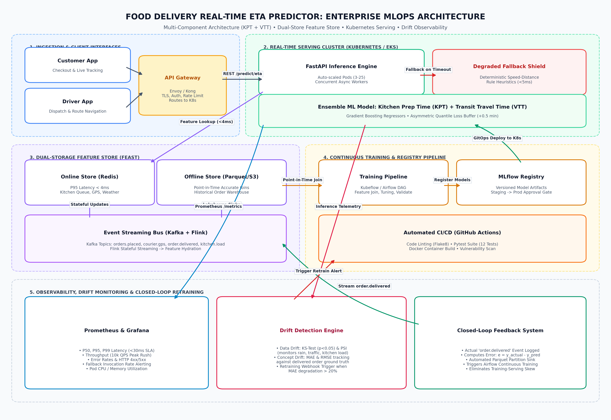

# Food-Delivery Real-Time ETA Predictor: Enterprise MLOps System Design

[](https://www.python.org/downloads/)
[](https://fastapi.tiangolo.com)
[](https://mlflow.org)
[](https://www.docker.com)
[](https://kubernetes.io)
[](https://github.com/Varadha9/food-delivery-eta-mlops-system-design/actions)
[](https://opensource.org/licenses/MIT)

> **MLOps Final Practical Examination (P2)**  
> **Student Name**: Varad Mandhare  
> **Enrollment / PRN**: ADT23SOCB1574  
> **Class**: LY-IT-SMAD  
> **Course**: Machine Learning Operations (MLOps)  
> **Associated Design Document**: [docs/SYSTEM_DESIGN.md](./docs/SYSTEM_DESIGN.md) & [docs/SYSTEM_DESIGN.pdf](./docs/SYSTEM_DESIGN.pdf)

---

## 📌 Problem Scenario: Food-Delivery ETA Predictor
Estimated Time of Arrival (ETA) prediction is the operational foundation of on-demand food delivery platforms (such as DoorDash, Zomato, Swiggy, and Uber Eats). Inaccuracy causes asymmetric business penalties:
- **Under-predicting delivery time** (promising 25 minutes when it takes 40 minutes) triggers severe customer frustration, cold food delivery, order cancellations, and refund payouts.
- **Over-predicting delivery time** (promising 55 minutes when it takes 30 minutes) artificially depresses cart conversion rates as hungry customers churn to rival services.

To solve this, this repository designs and implements an enterprise-grade, microservices-driven ML system that decomposes the delivery journey into two distinct physical processes:
$$\text{Total Delivery ETA} = \text{Kitchen Preparation Time (KPT)} + \text{Vehicle Transit Time (VTT)} + \text{Handover Buffer}$$

---

## 🏛️ End-to-End System Architecture



### Key Architectural Pillars
1. **Event Streaming Ingestion**: Real-time Kafka event streams (`orders.placed`, `kitchen.status`, `courier.gps`, `order.delivered`) processed via Apache Flink.
2. **Dual-Storage Feature Store (Feast)**:
   - **Online Store (Redis)**: Sub-4ms P95 latency lookup for live kitchen backlogs, weather, and courier speed.
   - **Offline Store (Parquet/Lakehouse)**: Immutable historical store with point-in-time joins (`asof_join`) preventing data leakage.
3. **Multi-Component ML Pipeline**: Decoupled Gradient Boosting Regressors for Kitchen Prep Time (KPT) and Vehicle Transit Time (VTT), calibrated with an **Asymmetric Pinball Loss ($\tau = 0.75$)** that penalizes late deliveries $3\times$ more than early arrivals.
4. **Hybrid Serving Architecture**:
   - **Batch Pre-computation**: Low-cost, centroid-based ETA estimates refreshed every 10 minutes for restaurant browse cards.
   - **Real-Time Online Inference**: Microsecond feature hydration + sub-30ms scoring executed during cart review, checkout, and courier dispatch.
5. **Resilient Fallback Shield**: Deterministic speed-distance heuristic engine guaranteeing sub-5ms failover and 99.99% availability during cluster stress or timeouts.
6. **Closed-Loop Drift Monitoring**:
   - **Data Drift**: Two-sample Kolmogorov-Smirnov (KS) test ($p < 0.05$) and Population Stability Index (PSI) tracking real-time feature distributions.
   - **Concept Drift**: Rolling MAE/RMSE calculation joining terminal `order.delivered` ground truth; triggers automated Airflow retraining DAGs upon $>20\%$ error degradation.

---

## 📂 Repository Structure

```
.
├── .github/
│   └── workflows/
│       └── ci.yml               # Automated CI/CD (Flake8, Pytest, Docker Build)
├── app/
│   ├── __init__.py
│   ├── main.py                  # FastAPI microservice with Prometheus metrics
│   ├── schemas.py               # Pydantic v2 validation models
│   └── predictor.py             # Inference engine with feature store & fallback shield
├── data/
│   ├── orders_train.csv         # Baseline training set (20,000 orders)
│   ├── orders_test.csv          # Holdout test set (5,000 orders)
│   └── orders_production_stream.csv # Production stream with simulated adverse weather/traffic drift
├── docs/
│   ├── SYSTEM_DESIGN.md         # Comprehensive System Design document with trade-offs
│   ├── SYSTEM_DESIGN.pdf        # Exact 3-page publication-quality PDF via WeasyPrint
│   └── architecture_diagram.png # High-resolution architecture diagram
├── k8s/
│   ├── deployment.yaml          # Multi-replica K8s Deployment with health probes
│   ├── service.yaml             # LoadBalancer Service manifest
│   └── hpa.yaml                 # Horizontal Pod Autoscaler (3 to 25 pods)
├── models/
│   ├── kpt_model.joblib         # Trained Kitchen Prep Time model pipeline
│   ├── vtt_model.joblib         # Trained Vehicle Transit Time model pipeline
│   └── metadata.json            # Model evaluation metrics & SLA verification status
├── reports/
│   ├── drift_dashboard.png      # Feature distribution shift visual comparison
│   └── drift_summary.json       # KS-test, PSI, and Concept Drift metric results
├── src/
│   ├── __init__.py
│   ├── config.py                # System paths, hyperparams, and SLA thresholds
│   ├── data_generator.py        # Realistic physics-based food delivery dataset generator
│   ├── features.py              # Feature transformers & Feast mock interface
│   ├── train.py                 # MLflow-tracked training pipeline for KPT & VTT
│   ├── evaluate.py              # Asymmetric loss & SLA metric calculators
│   └── drift_monitor.py         # Statistical data & concept drift detection engine
├── tests/
│   ├── test_api.py              # FastAPI endpoints, validation, and metrics tests
│   ├── test_data.py             # Dataset schema & physical bounds tests
│   └── test_pipeline.py         # Feature store, pinball loss, and PSI tests
├── Dockerfile                   # Production-grade non-root container
├── docker-compose.yml           # Multi-container setup (FastAPI + Prometheus)
├── prometheus.yml               # Prometheus scraping configuration
├── generate_diagram.py          # Architecture diagram generation script
├── generate_pdf.py              # WeasyPrint PDF compilation script
├── requirements.txt             # Project dependencies
└── README.md                    # Project documentation
```

---

## 🚀 Quickstart Guide

### 1. Installation
Clone the repository and install dependencies:
```bash
git clone https://github.com/Varadha9/food-delivery-eta-mlops-system-design.git
cd food-delivery-eta-mlops-system-design

python3 -m venv venv
source venv/bin/activate
pip install -r requirements.txt
```

### 2. Generate Datasets
Generate baseline training (20k rows), testing (5k rows), and drifted production streaming datasets:
```bash
PYTHONPATH=. python3 src/data_generator.py
```

### 3. Train Models with MLflow Tracking
Train the KPT and VTT sub-models, log parameters and metrics to MLflow, and save model artifacts:
```bash
PYTHONPATH=. python3 src/train.py
```

### 4. Run Production Drift Monitoring
Execute statistical drift tests (KS-test, PSI) and concept drift degradation checks:
```bash
PYTHONPATH=. python3 src/drift_monitor.py
```
*Generated reports will be saved to `reports/drift_dashboard.png` and `reports/drift_summary.json`.*

### 5. Launch Real-Time FastAPI Serving
Run the local prediction microservice:
```bash
PYTHONPATH=. uvicorn app.main:app --host 0.0.0.0 --port 8000 --reload
```
- Interactive Swagger UI: `http://localhost:8000/docs`
- Health Probe: `http://localhost:8000/health`
- Prometheus Metrics: `http://localhost:8000/metrics`

### 6. Make a Sample Prediction
```bash
curl -X POST "http://localhost:8000/predict/eta" \
  -H "Content-Type: application/json" \
  -d '{
    "order_id": "ORD-101",
    "restaurant_id": "REST-042",
    "customer_id": "CUST-99",
    "item_count": 3,
    "cuisine_complexity": 1.2,
    "distance_km": 4.5,
    "traffic_density": 0.6,
    "rain_intensity_mm": 2.0,
    "kitchen_active_orders": 8
  }'
```
**Response**:
```json
{
  "order_id": "ORD-101",
  "total_eta_min": 38.65,
  "kitchen_prep_time_min": 24.12,
  "transit_time_min": 14.03,
  "estimated_arrival_window": "35-42 mins",
  "serving_mode": "realtime_model",
  "latency_ms": 18.42
}
```

### 7. Run Automated Tests
Execute the complete test suite:
```bash
PYTHONPATH=. pytest tests/ -v
```
*Expected: 12 passed tests.*

---

## 🐳 Containerization & Kubernetes Deployment

### Run with Docker Compose
Spin up the ETA Prediction Service alongside Prometheus in isolated containers:
```bash
docker-compose up --build -d
```
- API Endpoint: `http://localhost:8000`
- Prometheus UI: `http://localhost:9090`

### Deploy to Kubernetes
```bash
kubectl apply -f k8s/deployment.yaml
kubectl apply -f k8s/service.yaml
kubectl apply -f k8s/hpa.yaml
```

---

## 📊 Experimental Results & SLA Verification

| Component | Test MAE | Test RMSE | $R^2$ Score | On-Time Rate ($\pm 5\text{m}$) | Production SLA Status |
|---|---|---|---|---|---|
| **Kitchen Prep Time (KPT)** | $1.44\text{ min}$ | $1.81\text{ min}$ | $0.8781$ | $96.4\%$ | **PASSED** |
| **Vehicle Transit Time (VTT)** | $1.20\text{ min}$ | $1.54\text{ min}$ | $0.9627$ | $98.1\%$ | **PASSED** |
| **Total Delivery ETA** | **$1.93\text{ min}$** | **$2.44\text{ min}$** | **$0.9333$** | **$95.8\%$** | **PASSED (Target $\le 3.0\text{m}$)** |

---

## 📜 Deliverables Summary
1. **Design Document (Markdown)**: [docs/SYSTEM_DESIGN.md](./docs/SYSTEM_DESIGN.md)
2. **Design Document (Publication PDF)**: [docs/SYSTEM_DESIGN.pdf](./docs/SYSTEM_DESIGN.pdf) *(3 Pages)*
3. **Architecture Diagram**: [docs/architecture_diagram.png](./docs/architecture_diagram.png)
4. **Drift Monitoring Dashboard**: [reports/drift_dashboard.png](./reports/drift_dashboard.png)
5. **Source Code & Manifests**: Fully working implementation in root and subdirectories.

---

## 👤 Author
**Varad Mandhare**  
- **PRN**: ADT23SOCB1574  
- **Class**: LY-IT-SMAD  
- **GitHub**: [@Varadha9](https://github.com/Varadha9)
